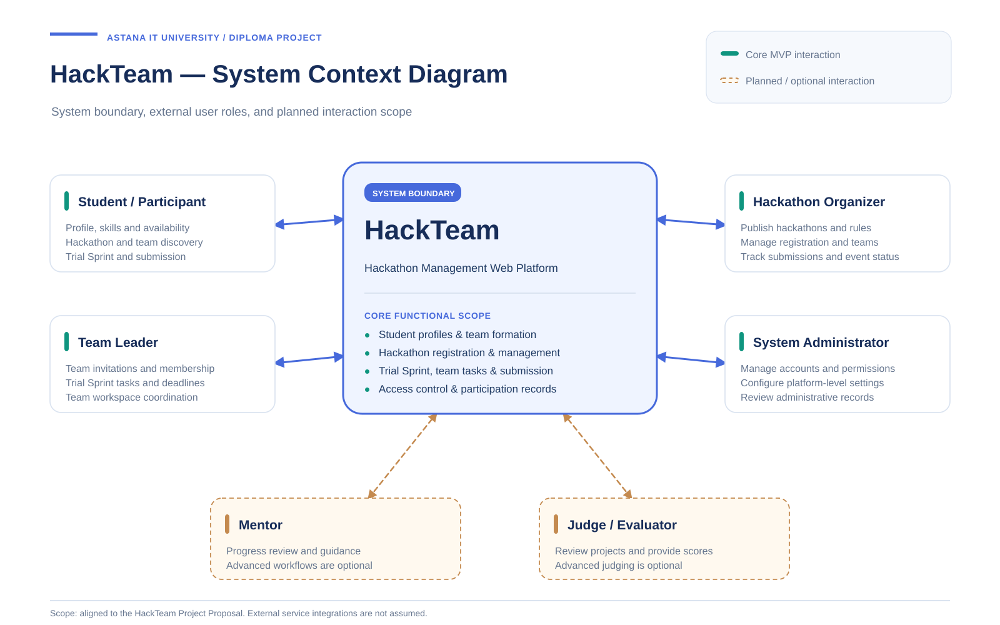
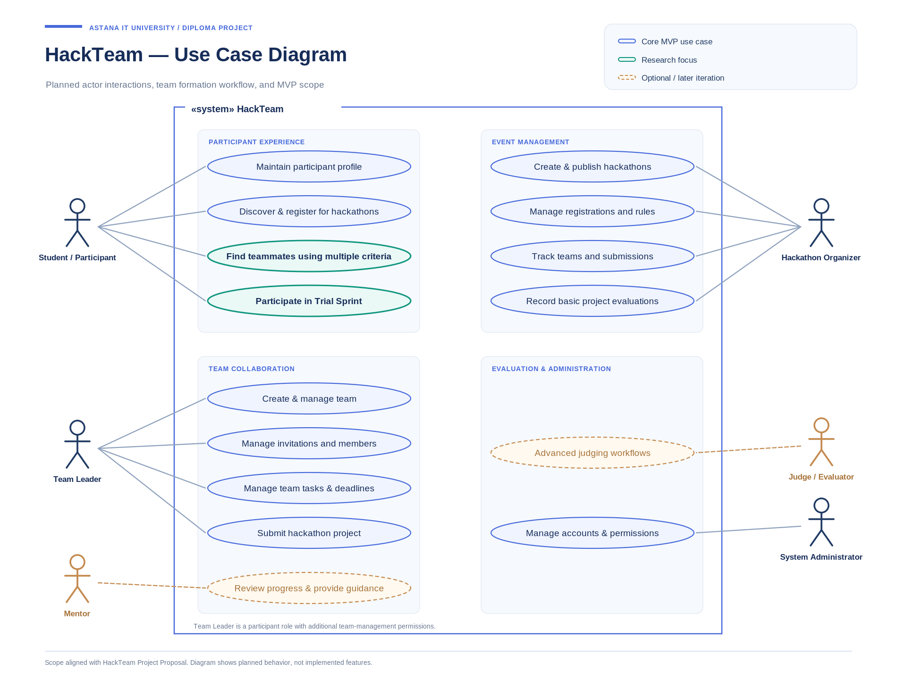
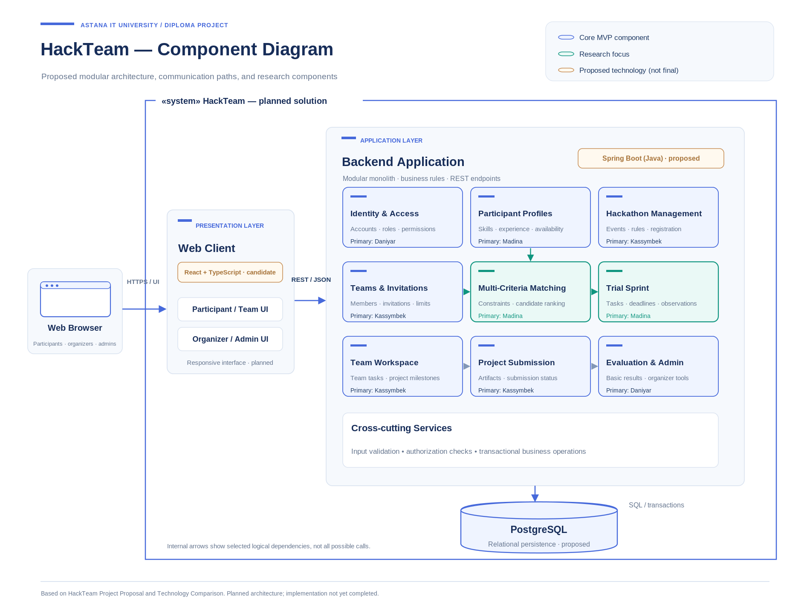

# HackTeam — System Architecture

**Related Issue:** HACK-7  
**Document Status:** Draft — Preliminary Architecture  
**Project:** HackTeam Diploma Project  
**Prepared by:** Yergalyuly Daniyar

## 1. Architecture Overview

HackTeam is a proposed web-based platform for managing student hackathons, forming teams through multi-criteria matching, and supporting preliminary team collaboration through Trial Sprint.

The purpose of the architecture is to define the system boundaries, external actors, major software components, and interactions between them.

The proposed system follows a modular monolithic architecture. Its main functionality is divided into logically separated modules within a single backend application.

The architecture is preliminary and will be refined based on approved requirements, implementation constraints, and supervisor feedback.

## 2. System Context Diagram

The System Context Diagram illustrates the HackTeam platform and its interactions with external user roles.

The primary actors are:

- **Student / Participant:** Maintains a profile, discovers hackathons, searches for teammates, participates in Trial Sprint, and submits projects.
- **Team Leader:** Manages team membership, invitations, tasks, and team coordination.
- **Hackathon Organizer:** Creates events, manages registrations, and monitors team participation and submissions.
- **System Administrator:** Manages platform accounts, permissions, and administrative settings.

Additional planned roles include:

- **Mentor:** Provides guidance and reviews team progress.
- **Judge / Evaluator:** Reviews submitted projects and provides evaluations.

Advanced mentor and judging functionality is outside the essential MVP scope.

The diagram defines the HackTeam platform as a single system boundary. External third-party integrations are not assumed at this stage.

## 3. Use Case Diagram

The Use Case Diagram identifies the main interactions between users and the HackTeam platform.

### 3.1 Participant Use Cases

Participants will be able to:

- Create and maintain participant profiles.
- Discover and register for hackathons.
- Search for suitable teammates.
- View multi-criteria matching recommendations.
- Participate in Trial Sprint activities.
- Manage team collaboration tasks.
- Submit hackathon projects.

### 3.2 Team Leader Use Cases

Team leaders will be able to:

- Create and manage teams.
- Invite and remove participants according to system rules.
- Manage team tasks and deadlines.
- Coordinate project preparation.

A team leader is treated as a participant with additional permissions related to team management.

### 3.3 Organizer Use Cases

Organizers will be able to:

- Create and publish hackathons.
- Define participation requirements.
- Manage registrations.
- Monitor teams and project submissions.

### 3.4 Administration and Evaluation

Administrators manage platform-level permissions and settings.

Basic evaluation support is planned for the MVP. Advanced judging workflows and mentor collaboration features may be introduced in later development stages.

## 4. Component Diagram

The Component Diagram illustrates the proposed internal structure of HackTeam.

The system is divided into three main architectural layers.

### 4.1 Presentation Layer

**Proposed Technology:** React with TypeScript.

The web client will provide interfaces for participants, team leaders, organizers, and administrators.

Its responsibilities include:

- User interaction and navigation.
- Form input and client-side validation.
- Displaying participant and hackathon information.
- Presenting team recommendations and Trial Sprint progress.
- Communicating with the backend through REST APIs.

Security-sensitive business rules must be enforced by the backend rather than relying only on frontend validation.

### 4.2 Application Layer

**Proposed Technology:** Java with Spring Boot.

The backend application will implement the core business logic and coordinate access to persistent data.

The planned logical modules are:

| Component | Responsibility | Primary Owner |
|---|---|---|
| Identity & Access | Authentication, authorization, accounts, and permissions | Daniyar |
| Participant Profiles | Skills, experience, preferences, and availability | Madina |
| Hackathon Management | Events, rules, and participant registration | Kassymbek |
| Teams & Invitations | Team membership, invitations, and participation constraints | Kassymbek |
| Multi-Criteria Matching | Candidate filtering, scoring, and recommendation explanations | Madina |
| Trial Sprint | Preliminary collaborative tasks, deadlines, and recorded outcomes | Madina |
| Team Workspace | Team tasks and project coordination | Kassymbek |
| Project Submission | Submission records and project information | Kassymbek |
| Evaluation & Administration | Basic evaluation support and administrative operations | Daniyar |

The modules represent logical responsibilities within the application and do not necessarily correspond to independently deployed services.

### 4.3 Data Layer

**Proposed Technology:** PostgreSQL.

The database will store structured information about participants, hackathons, teams, invitations, Trial Sprints, tasks, and submissions.

A relational data model is considered suitable because these entities contain multiple relationships and require data integrity.

Database constraints, transactions, and application-level validation will be used to maintain consistency.

The detailed database schema will be prepared during the implementation design stage.

## 5. Main System Interactions

### 5.1 Team Formation

1. A participant submits profile information through the web client.
2. The backend validates and stores the relevant profile data.
3. The participant requests teammate recommendations.
4. The matching component evaluates eligible candidates using defined criteria.
5. The system returns recommendations and available explanations.
6. Participants decide whether to invite or accept potential teammates.

The final decision to form a team remains under participant control.

### 5.2 Trial Sprint

1. Prospective teammates enter a preliminary collaboration stage.
2. Trial Sprint tasks and deadlines are created.
3. Participants update task progress and submit their results.
4. The system records observable task outcomes and structured feedback.
5. Participants review the results before confirming their final team.

Trial Sprint is designed to support decision-making and research. It does not guarantee future team compatibility.

### 5.3 Hackathon Submission

1. An organizer publishes a hackathon.
2. Participants register and form teams.
3. Teams prepare their projects in the workspace.
4. Authorized members submit project information.
5. The backend checks submission rules and deadlines.
6. The system stores the submission and makes it available to authorized organizers or evaluators.

## 6. Security and Data Integrity

The system will require authentication and role-based access control.

The backend must verify whether users are authorized to perform operations involving teams, hackathons, tasks, and submissions.

Important security considerations include:

- Secure password storage.
- Server-side authorization.
- Input validation.
- Protection against unauthorized data access.
- Secure session management.
- Appropriate handling of participant information.
- Data minimization and access restrictions.
- Protection against inconsistent concurrent updates.

For example, two simultaneous requests to join the final available position in a team must not result in an invalid team size.

Such behavior will require suitable transactional operations and automated testing.

## 7. Architectural Decisions

The current technical proposal recommends:

- **Frontend:** React with TypeScript (candidate).
- **Backend:** Spring Boot with Java.
- **Database:** PostgreSQL.
- **Communication:** REST API with JSON.
- **Architecture Style:** Modular monolith.

These decisions are based on the preliminary technology comparison documented in `docs/technology-comparison.md`.

The main reasons for the proposed architecture are maintainability, clear responsibility boundaries, data consistency, security, and manageable development complexity for a three-person team.

The matching algorithm and Trial Sprint mechanism will be implemented as part of HackTeam's own application logic. External AI services are not required for the core functionality.

## 8. Architecture Limitations and Future Work

This document represents a preliminary architecture rather than a completed implementation.

The following activities are planned for subsequent stages:

1. Finalize functional and non-functional requirements.
2. Define detailed database entities and relationships.
3. Specify REST API contracts.
4. Establish module interfaces and integration rules.
5. Implement authentication and authorization.
6. Develop and integrate the main application modules.
7. Perform integration, security, and concurrency testing.
8. Refine architectural decisions based on implementation results and supervisor feedback.

## 9. Conclusion

The proposed HackTeam architecture separates user interaction, business logic, and data persistence into clearly defined layers.

A modular monolithic approach is intended to support the development of a maintainable platform while allowing the three team members to work on distinct functional modules.

The architecture supports the project's main research direction: multi-criteria student team formation combined with preliminary assessment of team interaction through Trial Sprint.

The final architecture will be validated during development and testing.

## 10. Related Documentation

- [Project Proposal](project-proposal.md)
- [Technology Comparison](technology-comparison.md)
- [System Context Diagram](../diagrams/hackteam-system-context.drawio)
- [Use Case Diagram](../diagrams/hackteam-use-case.drawio)
- [Component Diagram](../diagrams/hackteam-component.drawio)
